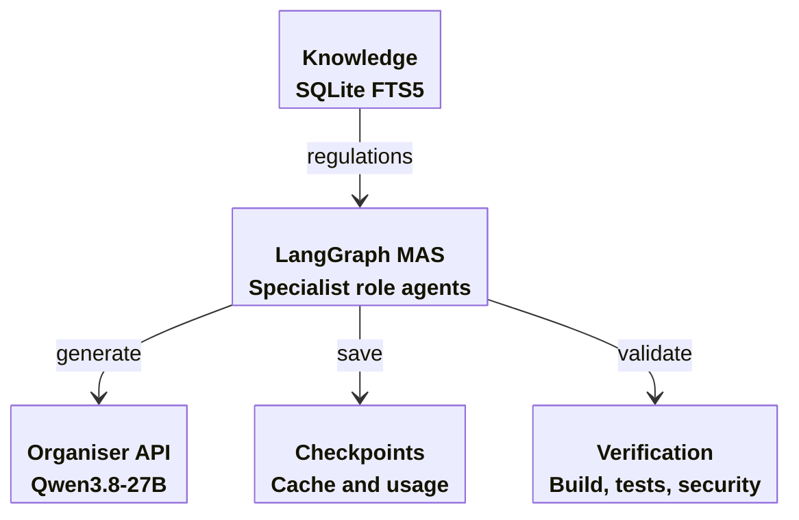
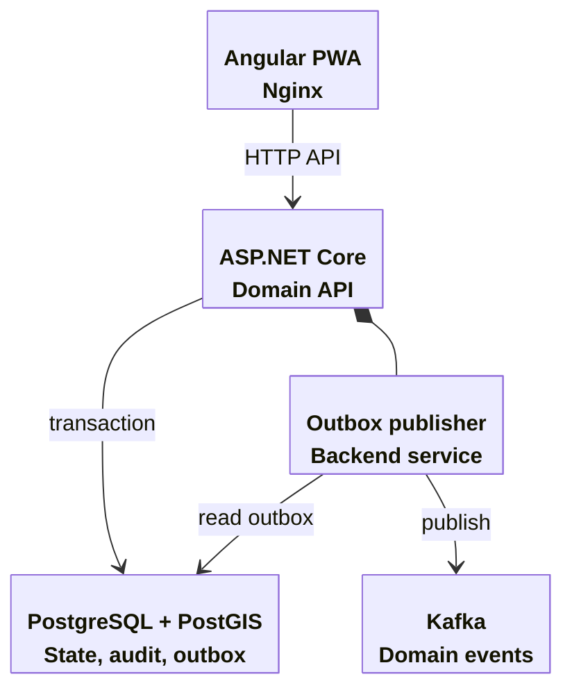

# RWB App Generator

Team TLE builds a requirements-driven application generator for the RWB hackathon. Business requirements are the domain input. Qwen3.8-27B produces system analysis, API contracts, domain code, an Angular interface, acceptance tests and handover documentation.

The generated stack is Angular 20.1.6 with Angular Material and PWA support, ASP.NET Core on .NET 10, PostgreSQL with PostGIS, Kafka and Docker Compose. Python and LangGraph coordinate specialist role agents. Corporate documentation is indexed locally with SQLite FTS5 and retrieved with source hashes.

## Architecture

The generator runs on the organiser VM. Every application generation request uses the organiser API and the fixed `qwen3.8-27b` model.




The generated deployment separates the interface, domain API, persistent storage and event transport. Domain state and an outbox record commit together. The publisher sends committed events to Kafka.




Role agents exchange typed contracts and artifact references instead of accumulating a shared transcript. Each agent can search the local knowledge index and read allowlisted artifacts. Build and independent review gates route concrete failures back to the responsible worker before downstream generation. See [agent design and research rationale](docs/agent-design.md) and [source-requirement checklist](docs/requirements-compliance.md).

These diagrams describe the target architecture. Deployment and acceptance status are reported separately in the generated evidence.

## Generation

Run generation, builds, tests and deployment on the organiser VM. Python 3.12 or later and Docker Compose are required.

```bash
python -m venv .venv
source .venv/bin/activate
python -m pip install -e ".[dev]"
export QWEN_BASE_URL=http://10.10.10.10:4000/v1
read -rs -p 'Qwen API key: ' QWEN_API_KEY
export QWEN_API_KEY
python main.py index knowledge/sources
python main.py generate examples/parking.md --answers examples/parking-answers.json --output runs/parking
```

Source PDF files, the chat export and real credentials are excluded from Git. Derived regulations and structured requirements may be versioned. Keep private deployment configuration on the VM.

Generation saves structured requirements, a shared API blueprint, source files, documents, requirement links and per-call token usage. Stage results are cached by prompt, schema and model inputs. Repeating the same run reuses completed model calls. Changed business requirements require a new output directory.

Critical ambiguities produce `docs/clarifications.json` and pause generation. Supply a JSON object mapping question IDs to answers through `--answers answers.json` and resume the same output directory. The completed analysis is reused and the answers are retained separately.

## Execution

```bash
python runs/parking/scripts/configure.py
python main.py verify runs/parking --execute --deploy --sudo
```

Generated applications listen on port 8080. The Swagger interface is at `/swagger/index.html`. API contracts are at `/openapi/v1.json`. Administrator and driver access tokens are generated in the application's local `.env` file. They are never embedded in frontend assets.

Checks use fixed Docker commands. The model cannot select host shell commands or modify platform dependencies. Acceptance tests execute in a container with a read-only filesystem, dropped capabilities and no Docker socket. Docker builds remain privileged infrastructure and require a trusted operator.

## Evidence

Each output contains `reports/checks.json`, individual check logs, `reports/security.json`, `reports/traceability.json`, `reports/summary.json` and a readable verification report. A check that was not executed is reported as `not_run`. Generated requirement links describe intended coverage and do not prove that a requirement passed.

A requirement passes only when named runtime tests succeed and independent assertion review identifies concrete checks for its acceptance criteria. Runtime verification and release readiness are reported separately.

The parking case is a preparation fixture. No parking-specific code is built into the generator. A second requirements file uses the same stages and platform templates.

## Development

```bash
python -m pytest
python -m ruff check .
```

Core modules are under `generator/`. Role instructions are under `generator/prompts/`. Target stack files are under `generator/templates/`. See [implementation status](docs/status.md), [architecture decisions](docs/architecture.md) and [evaluation procedure](docs/evaluation.md).

## Collaboration and releases

Team TLE maintains this repository collaboratively. Individual contributions are recorded in Git history and the [contributors view](https://github.com/pymlex/rwb-app-generator/graphs/contributors).

Keep `main` as the release baseline. Develop independent changes on short-lived branches and merge through pull requests after the required checks. The generator quality work is tracked separately from documentation changes. See [CONTRIBUTING.md](CONTRIBUTING.md) for branch, review and release rules.

A versioned release requires a clean deployment on the organiser VM, passing acceptance scenarios and retained security and token-usage reports. No application release has been declared yet.

## Current constraints

Generation and verification are separate. A successful generation is not a successful deployment. The live parking run and its check reports are pending. Demo bearer tokens must be replaced with enterprise identity integration for production. PWA installation and browser geolocation require HTTPS outside localhost.

The project is under GPL-3.0 license.
